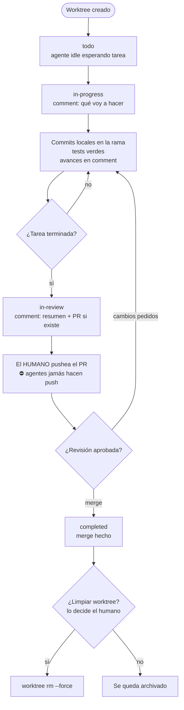

<!-- BEGIN:nextjs-agent-rules -->

## This is NOT the Next.js you know

This version has breaking changes — APIs, conventions, and file structure may all differ from your training data. Read the relevant guide in `node_modules/next/dist/docs/` (resolved from this file's directory; in monorepos the `next` package may not be visible from the repo root) before writing any code. Heed deprecation notices.

This block is written and re-added by `next dev` — verify at `node_modules/next/dist/server/lib/generate-agent-files.js`. Removing it from a diff only re-creates the uncommitted change; committing it with your work keeps the tree clean.

<!-- END:nextjs-agent-rules -->

## Workflow de tareas y tablero (Orca)

Este repo se gestiona con Orca. Cada tarea vive en un worktree (`~/orca/workspaces/<repo>/<nombre>`) con su rama, su tarjeta y su estado en el tablero. Los estados reflejan la fase REAL de la tarea; muévelos solo cuando la fase cambie.

### Regla de oro (no negociable)
- **JAMÁS hacer `git push`.** El push a remoto lo hace exclusivamente el humano.
- Trabaja SOLO en la rama del worktree y commitea LOCALMENTE.
- Entrega: rama con commits + resumen claro (comment de la tarjeta + respuesta final).
- Nada de borrar/archivar worktrees sin aprobación humana.

### Estados del tablero (solo estos; no inventar otros)
| Estado | Cuándo |
|---|---|
| `todo` | Worktree recién creado, sin trabajo |
| `in-progress` | Trabajo en curso (moverlo al ARRANCAR) |
| `in-review` | Listo para revisar / PR abierto (moverlo al TERMINAR) |
| `completed` | Mergeado / cerrado (después: limpiar SI el humano lo aprueba) |

### Ciclo de una tarea
1. Worktree creado → `todo`. (Si hay agente lanzado, está idle esperando la tarea.)
2. **Al arrancar:** `orca worktree set --worktree current --workspace-status in-progress --comment "<qué voy a hacer>"`.
3. **Durante:** commits locales con mensajes convencionales; tests verdes; avances en el comment de la tarjeta.
4. **Al terminar:** `orca worktree set --worktree current --workspace-status in-review --comment "<resumen + link de PR si existe>"`.
5. **Después del merge** (lo decide el humano): `--workspace-status completed` y limpiar el worktree solo si el humano lo pide.

### Diagrama de flujo

### Comandos operativos del agente
- Ver contexto: `orca worktree current --json` · `orca terminal read`
- Mover tarjeta: `orca worktree set --worktree current --workspace-status <id> --comment "..."`
- Pedir atención humana: `orca worktree set --worktree current --unread` (no inventar estados)
- Vincular PR/issue: `orca reference add <url> --worktree current`
- Esperar a otro agente: `orca terminal wait --for tui-idle --timeout-ms <ms>`
- Tickets vinculados (Linear/Jira): reflejar los mismos hitos (`orca linear status set`, `orca linear comment add`)

### Definition of Done
- Código en la rama del worktree, tests pasando, sin cambios sin commitear, tarjeta en `in-review` con comment actualizado, tickets actualizados. Push: SOLO el humano.
